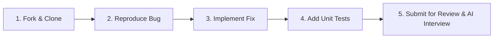

# Zero-to-Intern: Practical Bug Hunt Assessments

Welcome to the **Zero-to-Intern Bug Hunt** repository.

This repository contains practical software engineering debugging challenges designed to evaluate and build your readiness for real-world engineering internships. 

Real engineering work rarely begins with a blank file or a simple algorithm puzzle. You will often work with unfamiliar codebases, investigate bug tickets reported by users, write automated tests, and explain your technical decisions.

---

## How It Works: The 5-Step Assessment Workflow



1. **Fork this repository:** Click the **Fork** button at the top-right of this page to create your personal copy.
2. **Clone your fork locally:**
   ```bash
   git clone https://github.com/<your-username>/zero-to-intern-public.git
   cd zero-to-intern-public
   ```
3. **Navigate to your assigned task folder:** For example:
   ```bash
   # Level 1 Example:
   cd level-1-beginner/task-4-grade-calculator

   # Level 2 Example:
   cd level-2-intermediate/task-1-transaction-service

   # Level 3 Example:
   cd level-3-advanced/task-1-rate-limiter
   ```
4. **Investigate & Reproduce:** Read the task `README.md` to understand the scenario and bug tickets. Run the visible tests:
   ```bash
   python3 -m unittest discover tests
   ```
   Observe the failing reproduction tests.
5. **Fix & Test:** Implement your solution in `src/`. Add new test cases to `tests/` covering edge cases.
6. **Fill out the Submission Form:** Complete the `CANDIDATE_SUBMISSION.md` file in your task folder.
7. **Push & Submit:** Push your commits to your fork and submit your repository link to your mentor for automated validation and scheduling your **Technical AI Defense Interview**.

---

## Curriculum & Tracks

### Level 1: Beginner Python Debugging Track
Foundational single-file bugs testing core Python syntax, types, and logic.

| Assessment ID | Task Name | Key Concept Tested | Est. Time | Folder Link |
|:---:|---|---|:---:|:---:|
| **BH-L1-004** | **EduGrade Grade Calculator** | Conditionals & Control Flow (`if` fallthrough vs `elif`) | 30–45m | [`level-1-beginner/task-4-grade-calculator`](./level-1-beginner/task-4-grade-calculator) |
| **BH-L1-005** | **QuickSplit Bill & Tip Calculator** | Arithmetic (`/` vs `//`) & String Type Coercion | 30–45m | [`level-1-beginner/task-5-bill-splitter`](./level-1-beginner/task-5-bill-splitter) |
| **BH-L1-002** | **UserAuth Profile Data Sanitizer** | String Immutability & Method Assignment (`.strip()`, `.lower()`, `.title()`) | 45–60m | [`level-1-beginner/task-2-user-sanitizer`](./level-1-beginner/task-2-user-sanitizer) |
| **BH-L1-003** | **WeatherStation Temperature Analyzer** | List Iteration, Sentinel Traps (`min=0.0`), Empty List Handling | 45–60m | [`level-1-beginner/task-3-temperature-tracker`](./level-1-beginner/task-3-temperature-tracker) |
| **BH-L1-001** | **TalentCart Order Pricing** | Lists of Dictionaries, Item Eligibility Filtering | 60–75m | [`level-1-beginner/task-1-cart-pricing`](./level-1-beginner/task-1-cart-pricing) |

### Level 2: Intermediate Multi-File Bug Hunt Track
Multi-file domain architectures testing component boundaries, contracts, and compensation rollbacks.

| Assessment ID | Task Name | Key Concept Tested | Est. Time | Folder Link |
|:---:|---|---|:---:|:---:|
| **BH-L2-001** | **FinPulse Transaction Summary Service** | Component Contract Misalignment & Status Filter Leakage | 60–90m | [`level-2-intermediate/task-1-transaction-service`](./level-2-intermediate/task-1-transaction-service) |
| **BH-L2-002** | **ShipStream Inventory Allocator** | Transactional Compensation & Multi-Warehouse Rollback Failure | 60–90m | [`level-2-intermediate/task-2-inventory-allocator`](./level-2-intermediate/task-2-inventory-allocator) |

### Level 3: Advanced Unfamiliar Codebase Track
Stateful infrastructure codebases testing temporal algorithms, clock abstractions, and gap invalidation.

| Assessment ID | Task Name | Key Concept Tested | Est. Time | Folder Link |
|:---:|---|---|:---:|:---:|
| **BH-L3-001** | **CloudGate API Gateway: Sliding-Window Rate Limiter** | Temporal Decay Inversion, Multi-Window Gap Invalidation, Header Underflow | 90–120m | [`level-3-advanced/task-1-rate-limiter`](./level-3-advanced/task-1-rate-limiter) |

---

## Assessment Rules & Evaluation

- **Environment:** Requires Python 3.8 or newer. Zero external pip packages required across all tasks.
- **Contract Integrity:** Do not change public method signatures, module file names, or interface contracts.
- **Testing Discipline:** You must write new unit tests in `tests/` to prove your fix works across edge cases.
- **Deterministic Testing:** In Level 3 tasks, use the provided `TestClock` injection pattern rather than flaky `time.sleep()`.
- **Responsible AI Use:** You are permitted to use AI coding tools (e.g., Copilot, ChatGPT, Claude), but you must disclose their use in `CANDIDATE_SUBMISSION.md` and thoroughly understand your code. During the follow-up AI interview, you will be asked to explain your implementation line by line.

---

## Standard Scoring Rubric (100 Points)

| Competency | Weight | What Reviewers Look For |
|---|:---:|---|
| **Bug Resolution & Correctness** | **30 pts** | Your code passes all automated evaluation tests and handles edge cases without side-effects. |
| **Root-Cause Analysis** | **20 pts** | You clearly articulate the technical cause of the defect, not just the symptom. |
| **Testing & Regression Prevention** | **20 pts** | You wrote comprehensive automated unit tests covering boundaries and potential regressions. |
| **Code Quality & Engineering Judgment** | **15 pts** | Clean, idiomatic, readable Python adhering to repository conventions. |
| **Responsible AI Use & Verification** | **15 pts** | You take full ownership of your code, explain all decisions, and critically verify any tool output. |
| **Total** | **100 pts** | |
